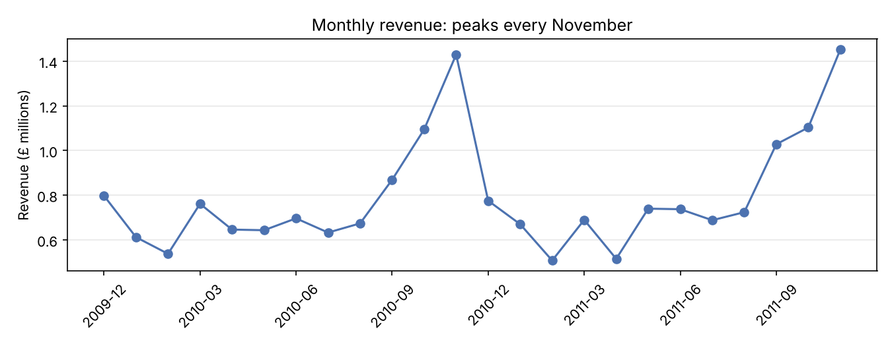

# Product Catalog Data Quality Audit

Cleaning and auditing two years of real e-commerce data to build a reliable product catalog, with every fix documented.

## The problem
An online wholesaler's raw sales data held about 1.07 million invoice lines. Mixed in with real product sales were duplicate entries, cancelled orders, postage and fee lines stored as products, warehouse notes like `CHECK` and `DAMAGED`, and the same product sold under several different names. Messy catalog data like this leads to wrong orders, confusing search results and sales reports that split one product into many.

## Part 1: Cleaning
| Step | Action | Rows affected |
|---|---|---|
| 1 | Profiled the data before changing anything | — |
| 2 | Standardized text: trimmed spaces, uppercased descriptions and stock codes | 253,546 descriptions, 3,472 codes reformatted |
| 3 | Removed exact duplicate rows | 34,335 removed |
| 4 | Removed cancelled invoices | 19,104 removed |
| 5 | Moved postage, fees, adjustments and gift vouchers to a separate file | 4,633 moved |
| 6 | Removed records missing a description, quantity or price | 5,961 removed |
| 7 | Built a product master with one official name per product | 4,723 products |
| 8 | Applied official names to every sales line | 58,116 lines renamed |

## Key findings
- **12.6% of products (595 of 4,723) were sold under more than one description.** Causes included spelling errors (`SPUNGE` vs `SPONGE`), punctuation (`WRAP, CAROUSEL` vs `WRAP CAROUSEL`) and renamed products (`POLKADOT` vs `WHITE SPOTS`).
- **173 stock codes appeared in both upper and lower case** (for example `79323P` and `79323p`). I checked them and confirmed they were the same products before merging.
- **Postage and fee lines were stored as products**, inflating catalog counts. They're kept in a separate file so no financial data is lost.
- **94% of the raw rows were kept** as clean, valid product sales.

## Part 2: SQL analysis
With the clean data loaded into SQLite, I answered nine catalog and sales questions (`02_sql_analysis.ipynb`, queries in `queries.sql`), using joins, CTEs, subqueries and window functions (`LAG`, `RANK`).

- **Products with conflicting names carry about 26% of revenue** (roughly £5.1 million), so the cleanup affects the products that sell, not just obscure ones. High-volume items like `JUMBO BAG RED RETROSPOT` are first in line.
- **Price checks caught likely catalog errors.** A car flag with a median price of £0.42 was recorded at £1,157.15, and a 60-piece bulk lot of picnic baskets was sold under the single basket's product code.
- **28.6% of products (1,352) had no sales in the final six months**, a large group to review for retirement.
- **Sales peak every November** at about £1.4 million, so seasonal catalog updates should be done by early fall.
- **The UK is 85.5% of revenue**, with Ireland, the Netherlands and Germany the largest international markets.

## Outputs
| File | Contents |
|---|---|
| `outputs/clean_transactions.csv.gz` | The clean sales data used in Part 2 |
| `outputs/product_master.csv` | One row per product: official description, number of name variants, price range, sales volume, review flag |
| `outputs/description_conflicts.csv` | Every product with conflicting names, with the chosen official name, for human review |
| `outputs/data_quality_log.csv` | Rows before and after each cleaning step |
| `outputs/non_product_lines.csv` | Postage, fees and adjustments separated from the catalog |
| `outputs/rows_removed_by_step.png` | Chart of rows removed at each step |

## How to run it
1. Download `online_retail_II.xlsx` from the [UCI Machine Learning Repository](https://archive.ics.uci.edu/dataset/502/online+retail+ii).
2. Open `01_data_cleaning.ipynb` in [Google Colab](https://colab.research.google.com/) or Jupyter, and upload the Excel file to the same folder.
3. Run all cells. Loading the Excel file takes a minute or two.
4. To run Part 2 on its own, open `02_sql_analysis.ipynb` and upload the `outputs` folder files it reads (`clean_transactions.csv.gz` and `product_master.csv`).

Requirements: Python 3, pandas, openpyxl, matplotlib (see `requirements.txt`). SQLite is built into Python.

## Limitations
- Cancelled invoices were removed, but the original orders some of them reversed were kept. Matching each cancellation to its original order is a planned improvement.
- The official name for each product is the most frequently used one. In a live catalog, a person would review the flagged conflicts before applying changes.

## Tools
Python (pandas, matplotlib), SQL (SQLite), Jupyter

## Next
- **Part 3:** a dashboard showing catalog health and sales trends

## Data source
Chen, D. (2012). *Online Retail II* [Dataset]. UCI Machine Learning Repository. https://doi.org/10.24432/C5CG6D. Licensed under CC BY 4.0.

## Author
RoShawn Frazier · [LinkedIn](https://linkedin.com/in/roshawn-frazier) · [GitHub](https://github.com/RoShawn-F)
